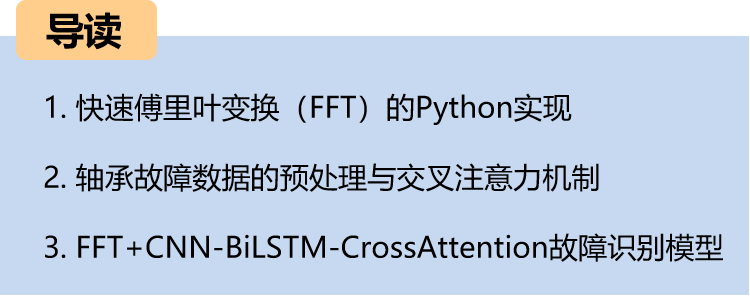
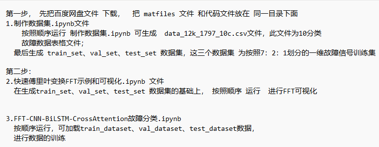

# Bearing Fault: FFT + CNN-BiLSTM-CrossAttention Identification Model for Integrating Time-Domain and Frequency-Domain Features

Recommendation - Family Pack, higher cost-performance ratio! Innovation in thesis!!!
The cross-attention mechanism can model the degree of correlation between different features. It extracts important features for model recognition from both frequency domain and time domain characteristics of fault signals, resulting in significant effects.
This includes a complete bearing fault dataset, as well as preprocessed fault signal datasets, classification data sets, and label sets that can be run, along with examples of Fast Fourier Transform (FFT) demonstrations.
With 50 epochs, an accuracy rate of 100%, the FFT+CNN-BiLSTM-CrossAttention network achieves remarkable results in classification. The model is capable of fully extracting spatial, temporal, and frequency domain features of bearing fault signals, with fast convergence speed and superior performance. To date, it is the most accurate method among previous articles. Innovation is also present!!!
Includes code for data preprocessing and the FFT+CNN-BiLSTM-CrossAttention classification code.
Environment: Python 3.9

Innovation Points: Utilizing the cross-attention mechanism to fuse models! Introduction

This paper introduces the Fast Fourier Transform (FFT) and data preprocessing based on the Case Western Reserve University (CWRU) bearing data, and finally implements the FFT-based CNN-BiLSTM-CrossAttention model for fault data classification using Python.
Overall Model Structure

The overall structure of the model is as follows: A one-dimensional fault signal undergoes FFT transformation of its frequency domain features and the signal's own time domain features separately through CNN convolutional pooling operations to extract global features. Then, it goes through BiLSTM to extract time series features. The cross-attention mechanism is used to fuse the time domain and frequency domain features. By calculating attention weights, the model focuses more on important features for feature enhancement and fusion. Finally, it passes through a fully connected layer and softmax to output classification results.
Time Domain and Frequency Domain Feature Extraction:
Applying FFT to the time-domain signal to convert it into the frequency domain.
\tLearn and extract frequency domain features using CNN.
CNN's convolutional layer can capture local patterns of frequency domain features.
\tBiLSTM network:
\tInput the time-domain signal into the BiLSTM network.
BiLSTM (Bidirectional Long Short-Term Memory Network) can effectively capture the long-term dependency relationship of time-domain signals.
Cross-attention mechanism:
\tUse cross-attention mechanism to fuse time-domain and frequency-domain features.
This can be achieved by calculating attention weights to make the model pay more attention to important features.
1. Introduction to the Principle of Fast Fourier Transform (FFT)
\tThe Fourier Transform is a tool for signal processing and spectral analysis, used to convert a signal from the time domain to the frequency domain. The Fast Fourier Transform (FFT) is an efficient algorithm for implementing the Fourier transform, particularly suitable for the processing of discrete signals.
Step 1: Importing partial data
from scipy.io import loadmat  
import numpy as np  
import matplotlib.pyplot as plt  
import matplotlib  
matplotlib.rc("font", family='Microsoft YaHei')  
# Read MAT file
data1 = loadmat('0_0.mat')  # Normal signal
data2 = loadmat('21_1.mat')  # 0.021 inch inner ring
data3 = loadmat('21_2.mat')  # 0.021 inch roller
data4 = loadmat('21_3.mat')  # 0.021 inch outer ring
# Note: The data read out is in dictionary format, which can be viewed through the function type(data).
Step 2: Visualization of fault signals
\t  
Step three, the fault signal is visualized through FFT.
\t  
2. Data Preprocessing for Bearing Faults
2.1 Import Data
Refer to the previous article for preprocessing of fault classification 10, and the Case Western Reserve University bearing data set: Classification 10 dataset.
\ttrain_set, val_set, test_set are all divided into training set, validation set and test set according to the ratio of 7:2:1, and finally save the data.
The above figure is the form of data reading and preprocessing ideas.
2.2 Creating the dataset and corresponding labels
3 Cross Attention Mechanism
\t3.1 Cross Attention Concept
\tThe two sequences must have the same dimensions.
\tThe two sequences can be different patterns (such as: text, sound, image).
A sequence as input defines the output sequence length, and another sequence provides the input K&V.
3.2 Cross-attention Algorithm
\tCalculate K and V for S1.
Calculate Q for S2
\tCalculate the Attention Matrix Based on K and Q
\tApply V to the Attention Matrix
The output sequence length is consistent with S2.
During the fusion process, we use the frequency domain features transformed by FFT as query sequences and temporal features as key-value pairs. By calculating the attention weights between the query sequences and the key-value pairs, we can model the degree of association between different features.
4 Bearing Fault Identification Model Based on FFT+CNN-BiLSTM-CrossAttention
4.1 Network Definition Model
\tNote: The input fault signal data has a shape of [32, 1024], batch_size=32, where 1024 represents the sequence length.
\t4.2 Set parameters and train the model
\t50 epochs, accuracy 100%, using an FFT+CNN-BiLSTM-CrossAttention integrated network model for classification, the model significantly improves the classification effect by fully extracting spatial and temporal features as well as frequency domain features from bearing fault signals. The convergence speed is fast, with superior performance, high accuracy, and the cross attention mechanism can model the degree of association between different features, extracting important features for model recognition from both frequency domain and time domain characteristics of fault signals, resulting in noticeable effects.
\t4.3 Model evaluation
\tAccuracy, Precision, Recall, F1 Score
\tFault classification confusion matrix:
\n        \n  
\t2. Friends who like this article can click to follow, give "likes" to the article, share on social media or discuss groups.

## Images

<!-- PAYMENT_BLOCK -->

## Get this dataset

- Payment link (Stripe): [Buy now](https://buy.stripe.com/3cs8yP7sY87d0vu9AB)
- Payment QR code: 

<!-- /PAYMENT_BLOCK -->
